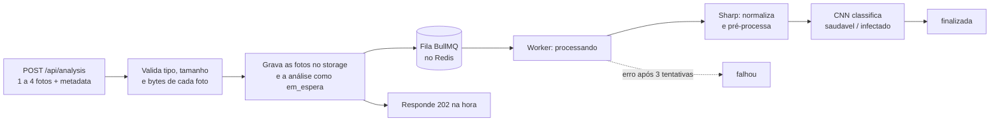

# VITA API

API REST do **VITA**, um sistema que identifica a **pinta preta dos citros** (*Phyllosticta citricarpa*) em fotos de tangerina Ponkan usando visão computacional.

A API é o back-end único do projeto: o painel web e o app mobile falam com ela. Ela cuida dos usuários, recebe as fotos, coloca cada análise numa fila de processamento, prepara as imagens, classifica e entrega o resultado, com as imagens servidas por URL assinada.

> Projeto Integrador da Fatec, desenvolvido pela equipe **ByteForge**. Esta é a segunda versão da API: a primeira foi escrita em JavaScript com MySQL, e estamos migrando para TypeScript com PostgreSQL + PostGIS. Hoje a classificação ainda é **simulada**; o modelo de verdade está sendo treinado no repositório `vita-ai`.

---

## Sumário

- [Por que o VITA existe](#por-que-o-vita-existe)
- [Onde a API entra no projeto](#onde-a-api-entra-no-projeto)
- [Tecnologias](#tecnologias)
- [Arquitetura](#arquitetura)
- [Rotas](#rotas)
- [Como rodar](#como-rodar)
- [Features](#features)
- [Equipe](#equipe)

---

## Por que o VITA existe

A tangerina Ponkan é uma das culturas mais importantes do Vale do Ribeira, e boa parte da produção vem da agricultura familiar. A pinta preta é uma doença causada por fungo que mancha a casca e derruba o fruto antes da hora. Fruto manchado perde valor de venda. Além disso, as lesões podem ser confundidas com dano mecânico ou de inseto, então nem sempre o produtor tem certeza do que está vendo.

A ideia do VITA é dar ao produtor uma segunda opinião rápida: ele tira fotos do fruto, uma rede neural convolucional (CNN) classifica a imagem como **com** ou **sem** pinta preta, e o sistema sugere um plano de ação. Com a localização das fotos, também dá para ver no mapa onde a doença está aparecendo.

## Onde a API entra no projeto

| Repositório | O que faz |
| --- | --- |
| **`vita-api`** (este) | Usuários, análises, fila de processamento, imagens e mapa |
| Web | Painel de gestão e consulta (Next.js) |
| `vita-app-mobile` | App Android de campo (React Native + Expo) |
| `vita-ai` | Treino da CNN e o serviço de inferência (FastAPI) que vai substituir a simulação |
| `vita-database` | Modelagem do banco de dados |

## Tecnologias

| Tecnologia | Para que usamos |
| --- | --- |
| Node.js 24 + TypeScript 7 | Runtime e linguagem (em desenvolvimento, o `tsx` roda o TypeScript direto) |
| Express 5 | Rotas e middlewares; captura sozinho os erros de handlers `async` |
| PostgreSQL 17 + PostGIS 3.5 | Banco de dados; o PostGIS guarda a localização das análises como ponto geográfico |
| Sequelize 6 | ORM; as **models são a fonte de verdade** do banco |
| Redis 7.4 + BullMQ + ioredis | Fila das análises: a requisição responde na hora e o processamento roda em segundo plano |
| Multer + `file-type` | Upload em memória e conferência do tipo real do arquivo pelos bytes |
| Sharp | Normalização e pré-processamento das imagens |
| Zod 4 | Validação do `.env`, do corpo, da query e dos parâmetros |
| JWT + bcrypt | Autenticação por token e hash das senhas |
| Docker Compose | Postgres, Redis, pgAdmin e a própria API em containers |
| pnpm 11 | Gerenciador de pacotes |

> O `mysql2` ainda aparece nas dependências por herança da API em JavaScript. Ele não é usado e deve sair numa limpeza futura.

## Arquitetura

### Pastas

Cada domínio é um módulo com as mesmas camadas: **routes → controller → service**. Os schemas Zod validam a entrada, e os DTOs tipam o que entra e sai.

```
src/
├── server.ts                 # sobe banco, storage, Redis, fila e worker, nessa ordem
├── app.ts                    # Express: CORS, JSON, rotas, middleware de erro
├── routes/index.ts           # tudo sob /api
├── modules/
│   ├── users/                # cadastro, login, /me e foto de perfil
│   ├── analyses/             # upload, lista, detalhes, status e mapa
│   │   └── jobs/             # fila, worker e processador (BullMQ)
│   ├── files/                # entrega de arquivos por URL assinada
│   ├── images/ processed/ classifications/   # services usados pelo processamento
│   └── health/               # GET /api/health
└── shared/
    ├── config/               # .env validado com Zod, Sequelize, Redis, CORS, Multer, storage
    ├── models/               # models Sequelize (Usuario, Analise, Imagem, Processada, Classificacao)
    ├── database/             # init, reset (sync), seed e trava contra rodar em produção
    ├── storage/              # interface StorageProvider + driver local + URLs assinadas
    ├── image/                # pipelines do Sharp
    ├── cnn/                  # classificador simulado (mesma interface do modelo real)
    ├── middlewares/          # autenticação, validação, upload, erro global
    ├── errors/               # AppError e tradução de erros do Zod, Multer, Sequelize e storage
    └── utils/                # JWT, geo, unidades, resposta HTTP
```

### O caminho de uma análise



Alguns detalhes que demoramos a acertar:

- **A requisição não espera a classificação.** Ela responde `202` com o `id`, e o cliente consulta `GET /api/analysis/:id/status` ou recarrega a lista.
- **O worker tenta 3 vezes**, com espera exponencial entre as tentativas. Se a API cair no meio, as análises `em_espera` voltam para a fila no próximo boot.
- **A localização da análise** sai das fotos: a API escolhe a melhor leitura de GPS (precisão de até 20 m) e grava como ponto PostGIS. É isso que alimenta o mapa.

### Contrato das respostas

Toda resposta JSON usa o mesmo envelope:

```json
{ "success": true, "message": "Análises listadas com sucesso", "data": { } }
```

```json
{ "success": false, "message": "Dados inválidos", "errors": [{ "field": "senha", "message": "Senha é obrigatória" }] }
```

Convenção de nomes que adotamos:

| Tipo de campo | Convenção | Exemplos |
| --- | --- | --- |
| Domínio (atributos das models) | português, snake_case | `criado_em`, `total_imagens`, `capturada_em` |
| Envelope | inglês | `success`, `message`, `data`, `errors` |
| Paginação, período e transporte | inglês, snake_case | `page`, `limit`, `total_pages`, `from`, `to`, `images`, `metadata` |

### Imagens por URL assinada

As respostas nunca trazem o caminho interno do arquivo. No lugar dele vem uma `url` como esta:

```
http://localhost:8080/api/files/analises/<usuario>/<analise>/<imagem>/original.jpg?expires=...&signature=...
```

A assinatura (HMAC-SHA256) cobre o caminho e a validade. Se alguém altera qualquer um dos dois, a API responde 403. A rota de arquivos não pede token, porque o `` do navegador não envia header: quem tem a URL é quem a recebeu numa rota autenticada.

Escolhemos esse modelo pensando no futuro. Quando o storage sair do disco local para um bucket (ex.: Cloudflare R2), só o driver muda: o bucket gera a própria URL assinada, e o contrato fica igual.

## Rotas

Todas ficam sob `/api`. As marcadas com "sim" na coluna Token exigem o header `Authorization: Bearer <token>`.

| Método | Rota | Token | O que faz |
| --- | --- | --- | --- |
| GET | `/health` | não | Estado da API, do Postgres, do Redis e do storage |
| POST | `/user/register` | não | Cadastro (devolve `usuario` e `token`) |
| POST | `/user/login` | não | Login (devolve `usuario` e `token`) |
| GET | `/user/me` | sim | Dados do usuário logado |
| PUT | `/user/me` | sim | Atualiza os dados do usuário |
| PUT | `/user/me/photo` | sim | Troca a foto de perfil (campo `photo`) |
| DELETE | `/user/me` | sim | Desativa a conta (exclusão lógica) |
| POST | `/analysis` | sim | Cria uma análise: campo `images` (1 a 4) + `metadata` (JSON opcional) |
| GET | `/analysis?page&limit&from&to` | sim | Lista paginada (até 100 por página) |
| GET | `/analysis/map?from&to&status&classe` | sim | Pontos do mapa |
| GET | `/analysis/:id` | sim | Detalhes, imagens e classificação |
| GET | `/analysis/:id/status` | sim | Só o status (para consultar depois do upload) |
| GET | `/files/*key?expires&signature` | não | Entrega o arquivo de uma URL assinada (a assinatura faz o papel do token) |

## Como rodar

### Requisitos

- Node.js 24 (a mesma versão do Dockerfile)
- pnpm 11: `corepack enable` já deixa a versão do `packageManager` disponível
- Docker e Docker Compose

### Opção 1: banco e Redis no Docker, API na sua máquina

É o jeito que mais usamos no dia a dia, porque o `tsx watch` reinicia a API a cada alteração.

```bash
pnpm install
cp .env.example .env       # ajuste se precisar; os padrões funcionam localmente
pnpm docker:infra          # sobe Postgres (com PostGIS) e Redis
pnpm db:fresh              # cria as tabelas a partir das models e carrega o seed
pnpm dev                   # API em http://localhost:8080
```

Para conferir, abra [http://localhost:8080/api/health](http://localhost:8080/api/health).

### Opção 2: tudo no Docker

```bash
cp .env.example .env
pnpm docker:watch          # sobe tudo e sincroniza o src/ com o container
pnpm docker:db:fresh       # em outro terminal: cria as tabelas e carrega o seed
```

### Usuários do seed

| E-mail | Senha | Perfil |
| --- | --- | --- |
| `produtor@vita.dev` | `senha123` | produtor |
| `estudante@vita.dev` | `senha123` | estudante |

### Variáveis de ambiente principais

O `.env` é validado com Zod no boot: se faltar algo obrigatório, a API não sobe e diz qual variável está errada. O `.env.example` tem todas as variáveis; as que mais aparecem nas dúvidas são estas:

| Variável | Exemplo | Para que serve |
| --- | --- | --- |
| `DB_*` | `DB_HOST=localhost` | Conexão com o Postgres |
| `REDIS_HOST`, `REDIS_PORT` | `localhost`, `6379` | Conexão com o Redis |
| `JWT_SECRET`, `JWT_EXPIRES_IN` | `1h` | Assinatura e validade do token de login |
| `URL_WEB`, `URL_EXPO` | `http://localhost:3000` | Origens liberadas no CORS |
| `STORAGE_ROOT` | `./storage` | Pasta onde ficam as imagens |
| `STORAGE_PUBLIC_URL` | `http://localhost:8080/api/files` | Endereço das imagens que o navegador ou o celular vai acessar |
| `STORAGE_URL_SECRET` | (32+ caracteres) | Chave das URLs assinadas; precisa ser diferente do `JWT_SECRET` |
| `STORAGE_URL_TTL_MINUTES` | `60` | Validade de cada URL de imagem |

### Scripts

| Comando | O que faz |
| --- | --- |
| `pnpm dev` | API com recarga automática (`tsx watch`) |
| `pnpm build` / `pnpm start` | Compila para `dist/` e roda a versão compilada |
| `pnpm db:fresh` | Recria o banco do zero e carrega o seed (**apaga tudo**) |
| `pnpm db:reset` / `pnpm db:seed` | Só recria as tabelas / só carrega o seed |
| `pnpm docker:infra` | Sobe só Postgres e Redis |
| `pnpm docker:up` / `pnpm docker:watch` | Sobe tudo no Docker (o `watch` sincroniza o código) |
| `pnpm docker:tools` | Sobe o pgAdmin em [http://localhost:5050](http://localhost:5050) |
| `pnpm docker:logs` | Logs da API no container |
| `pnpm docker:psql` / `pnpm docker:redis` | Terminal do Postgres / do Redis |
| `pnpm docker:down` / `pnpm docker:reset` | Para os containers / para e **apaga os volumes** |

### Problemas que já tivemos

- **`relation "analises" does not exist`.** A API não cria as tabelas no boot: quem cria é o `pnpm db:fresh`. Acontece no primeiro uso e depois de um `pnpm docker:reset`.
- **`Script destrutivo bloqueado`.** O `db:reset` só roda com `NODE_ENV` diferente de `production` e com um `DB_HOST` local (`localhost`, `127.0.0.1`, `db` ou `postgres`). Essa trava é proposital.
- **Imagens não carregam no celular.** No aparelho, `localhost` é o próprio celular. Use o IP do computador na rede no `STORAGE_PUBLIC_URL` (ex.: `http://192.168.0.10:8080/api/files`) e reinicie a API.
- **Arquivo não encontrado (404) nas imagens do seed.** É esperado: o seed grava as análises no banco, mas não cria os arquivos.

## Features

### Funcionando

- [x] Cadastro e login com JWT. As senhas são guardadas com bcrypt, e o login não revela as regras de senha
- [x] Perfil do usuário: ver, editar, trocar a foto e desativar a conta (exclusão lógica)
- [x] Upload de 1 a 4 fotos por análise, com conferência do tipo real pelos bytes e limite de 5 MB por foto
- [x] Metadados por foto (horário e GPS), com escolha automática da melhor localização para a análise
- [x] Processamento assíncrono com BullMQ: fila, 3 tentativas com espera exponencial e retomada após reinício
- [x] Pré-processamento das imagens com Sharp (orientação EXIF, ajuste de cor e redução de ruído)
- [x] Classificação binária `saudavel` / `infectado`, com confiança, tempo de execução e versão do modelo
- [x] Lista paginada com filtro de período, detalhes, consulta de status e mapa com filtros (PostGIS)
- [x] Imagens entregues por URL assinada e com validade, sem expor o caminho interno
- [x] Validação do `.env`, do corpo, da query e dos parâmetros com Zod
- [x] Erros num formato único, inclusive os do Zod, do Multer, do Sequelize e do storage
- [x] Ambiente Docker com Postgres + PostGIS, Redis, pgAdmin e a API com `watch`

## Equipe

**ByteForge**: Arthur Parra, Danieli Fiel, Guilherme Pereira, Gustavo Kletelinger e Matheus Oliveira.

Faculdade de Tecnologia do Estado de São Paulo (Fatec).
